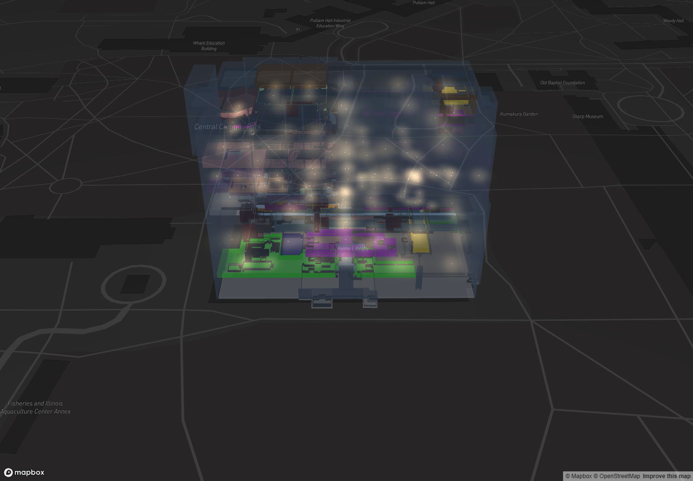
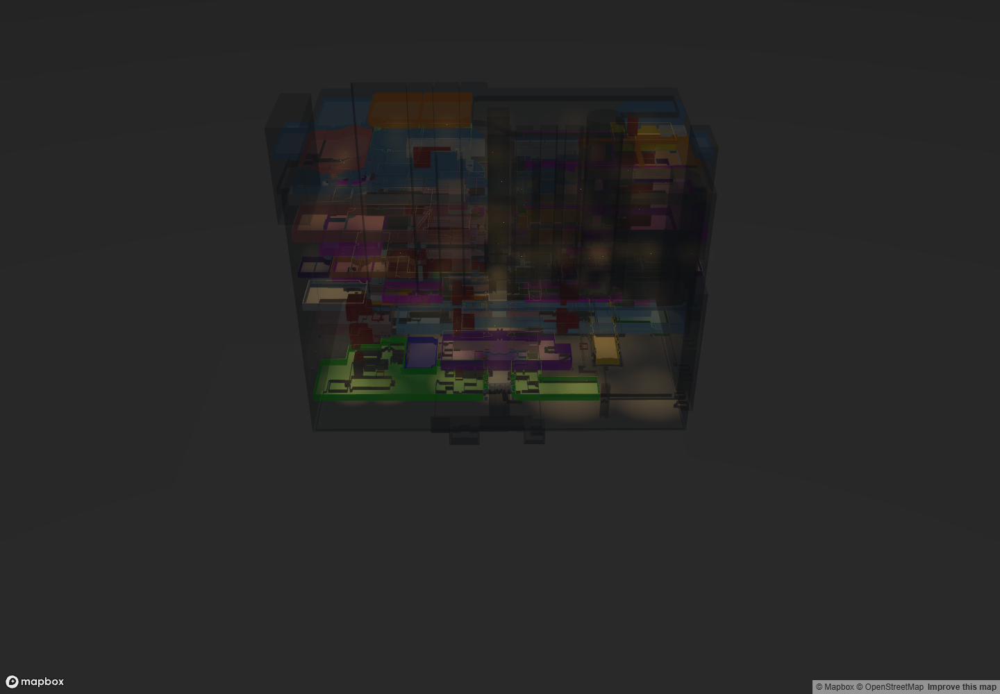
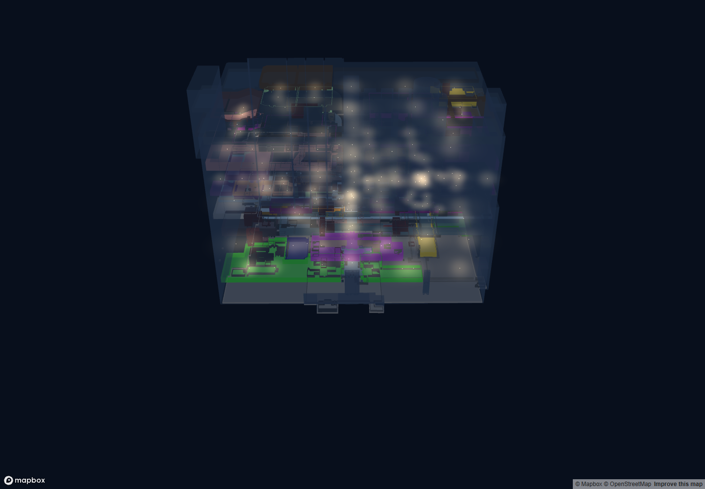
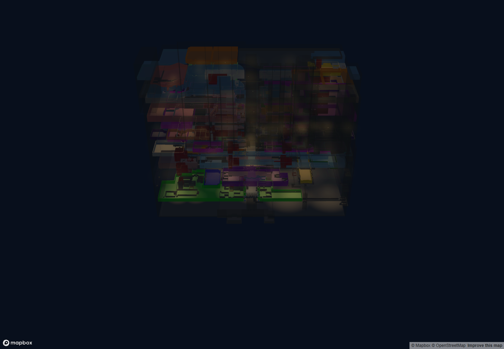

# Morris Library Night Mode refinement

The existing deck.gl renderer now shades nearby room and wall surfaces with local, smoothly attenuated light, accompanied by smaller warm fixtures and restrained halos. The exterior uses a neutral charcoal treatment. Source room colors and light attributes remain authoritative.

## 1. Causes of pale lighting

The previous fixture pass used additive `SRC_ALPHA / ONE` blending, so overlapping halos accumulated toward white. Fixture highlights mixed approximately 35% white into the source color. Large bright cores and visible halos carried most of the effect, while a CPU sampler assigned one illumination color to an entire room. The blue translucent exterior further weakened the apparent warmth.

There was no HDR framebuffer or postprocessing bloom threshold to tune. The apparent bloom was three instanced sprite layers. The old room tint calculation mixed display-space RGB values rather than accumulating linear light.

## 2. Files and rendering functions

| File | Change |
| --- | --- |
| `src/utils/nightLightingConfig.js` | Central defaults, source-derived palettes, sRGB conversions. |
| `src/layers/interiorLightLayer.js` | `createInteriorLightLayers`: smaller soft cores, subdued halos, source-over compositing. |
| `src/utils/interiorLighting.js` | `createRoomLightSampler`: cached candidate sources and containment; `lightLocalHeight` / `positionLight`: explicit local elevation; `nightEnvelopeLayers`: neutral shell and reliable mode restoration. |
| `src/utils/surfaceLighting.js` | `buildSurfaceLightField`: cached per-feature source atlas; CPU reference for regression tests. |
| `src/layers/nightSurfaceLayer.js` | `NightSurfaceLayer`: fragment illumination on existing polygon tops/sides, shared GPU atlas and resource disposal. |
| `src/components/IndoorBuilding.jsx` | `useIndoorBuilding`: night-only surface sublayers, floor datum metadata, protected navigation colors, restrained floor/wall opacity. |
| `src/components/Map3D.jsx` | Pass tuning through the existing light, room and shell layers. |
| `src/App.jsx`, `src/components/MultiFloorRouteTimeline.jsx` | Share tuning with the main map and route views. |
| `src/components/VisualControls.jsx`, `src/App.css` | Compact expandable Night lighting section within Visual settings. |
| `src/utils/surfaceLighting.test.js`, `src/utils/interiorLighting.test.js` | Surface, source, elevation, boundary, cache and envelope regressions. |
| `review/lighting-review.html`, `review/lighting-review.jsx`, `review/verify-night-lighting.mjs` | Development-only browser review and GPU checks. |

Existing unrelated working-tree changes were preserved. SHA-256 comparison of all 51 public GeoJSON files found no changes during this task.

## 3. Color, exposure and glow

Fixture sprites use ordinary source-over compositing rather than additive accumulation. The primary color remains the GeoJSON color; derived halos alter saturation/lightness while preserving hue. The highlight mixes only 8% white. The fixture core is clamped to 0.35–1.4 screen pixels, with wider, lower-opacity halos.

Surface shading decodes source/base sRGB, sums local contributions in linear space, applies night-only exposure and peak-channel compression, then encodes sRGB once. Dividing radiance by `1 + max(radiance)` limits overexposure while retaining channel ratios. This is a lightweight emissive visualization, not a physically based global illumination model. No whole-scene exposure, bloom or blur was added; the basemap and navigation overlays retain their own rendering.

## 4. Surface illumination

Each existing polygon receives a cached list of same-floor sources. The fragment shader evaluates 3D distance and a smoothstep falloff using each source's `radius_m`, `intensity`, `color` and local `z_height`. Disabled sources are excluded by the existing loader. Explicit `z_height = 4.3` is now honored; sources without it retain the previous base-plus-half-height fallback.

Room containment, including polygon holes, distinguishes internal sources from neighboring sources. Cross-boundary contribution is reduced to 18%; this is a containment approximation, not ray-traced wall occlusion. Existing floor polygons can receive their floor's light without that room-boundary reduction. Original room colors act as reflectance; route endpoints, highlighted rooms, landmarks and used connectors bypass the night shading treatment.

Lighting uses deck.gl's projected meter scale and a split-precision geographic origin. Existing floor datums, stack offsets, geometry and camera calculations remain in place. Reveal animation temporarily suppresses surface contributions until each floor is revealed.

## 5. Exterior and depth

The original shell geometry receives charcoal RGB `[27,32,38]`, low opacity and a restrained cool Phong highlight. Single-floor opacity is 0.18; stacked opacity is 0.144. This is transparent mesh shading, without simulated refraction or environment reflections.

Existing floor polygons use low night opacity, and stacked interior walls use 72% of their existing opacity. A subtle shader treatment on the top/bottom edges of existing wall sides helps floor separation. No slabs, windows, shelves or other architecture were added.

Separate night layer IDs and fresh day shell descriptors avoid reusing stale night color buffers or finalized layer instances during repeated toggles.

## 6. Default tuning

| Parameter | Default |
| --- | --- |
| `warmth` | 0.65 |
| `glowStrength` | 0.45 |
| `glowRadiusScale` | 1.1 |
| `coreBrightness` | 0.65 |
| `coreRadiusScale` | 0.7 |
| `coreMinPixels`, `coreMaxPixels` | 0.35, 1.4 |
| `highlightMix` | 0.08 |
| `surfaceIlluminationStrength` | 1.4 |
| `nightExposure` | 1 |
| `roomAmbient`, `wallAmbient` | 0.075, 0.045 |
| `surfaceColorRetention` | 0.65 |
| `boundaryTransmission` | 0.18 |
| `nightEnvelopeOpacity` | 0.18 |
| `stackedEnvelopeScale` | 0.8 |
| `stackedWallOpacityScale` | 0.72 |
| `envelopeColor` | `[27,32,38]` |
| `envelopeSpecularColor` | `[55,65,75]` |
| `floorOpacity`, `floorColor` | 0.025, `[110,116,123]` |
| `floorEdgeStrength` | 0.08 |

Visual settings → Night lighting exposes Warmth, Glow strength, Interior illumination and Exterior transparency. Transparency is displayed as `1 - nightEnvelopeOpacity`, initially 82%. No nonfunctional bloom control is exposed.

## 7. Visual limitations

The photograph contains neutral finishes, detailed glazing, ceiling fixtures, bookshelves and physical reflections absent from the GIS model. Strong green/purple GIS room colors therefore remain visible, and the result intentionally does not reproduce the photograph literally. Ordinary alpha blending still has transparency ordering limitations in dense F-ALL views. There are no dynamic shadows or true bounce lighting.

The current runtime loads the combined `interior_lights.geojson`. It contains 138 enabled anchors across F0–F6 and no F7 anchors; F7 retains ambient shading rather than receiving invented lights. Separate floor exports differ in radius from the combined file; the loader and datasets were not changed to reconcile them.

## 8. Performance

No per-anchor dynamic light or shadow map was added. The three existing instanced fixture passes remain. Surface illumination reuses existing polygon draws with one additional metadata attribute. A shared float texture supplies up to 32 candidate sources per feature, with early exit at the actual count. No source lists in the supplied datasets exceeded the cap.

The F-ALL atlas has 1,608 rows, 1,712 feature/source contributions and approximately 1.65 MB of pixel data. CPU fields are weakly cached by sampler and data; GPU textures are shared between room and wall layers, reference counted and deleted when no longer used. Camera movement and tuning do not rebuild the atlas. Floor changes can upload a cached CPU field to the GPU again.

Browser checks confirmed texture reuse during camera movement and deletion on leaving Night Mode. Verification used headless Chrome with software WebGL; interactive frame rates on target GPUs were not benchmarked. Devices without float textures fall back to ambient surface shading while retaining fixture sprites.

## 9. Verification

| View | Enabled fixtures | Result |
| --- | ---: | --- |
| F0 | 19 | Rendered |
| F1 | 20 | Rendered; room picking and route overlay checked |
| F2 | 23 | Rendered |
| F3 | 16 | Rendered |
| F4 | 23 | Rendered |
| F5 | 19 | Rendered |
| F6 | 18 | Rendered |
| F7 | 0 | Rendered with ambient shading |
| F-ALL | 138 | Stacking, rotation, zoom, pitch and cinematic reveal checked |

GPU checks cover float-atlas readback, no truncated source lists, shared texture lifetime, repeated mode toggles and single fixture-layer instances. See [browser-results.json](browser-results.json) for captured diagnostics. The application UI was also exercised: all four controls appeared, and setting interior illumination to 1.6 reached the active surface layer.

Fresh day renders before and after were pixel-identical with the asynchronous basemap hidden. After correcting shell state reuse, the night-to-day rendering also matched the original fresh day render pixel for pixel.

The production build passes, with the existing large-bundle warning. `npm test -- --run src routing --silent` finishes with 99 passed and 11 failed tests across 13 files. The baseline already had those same 11 failures: two missing-color restoration assertions in `featureColors.test.js` and nine missing-room lookup failures in `routeAnchors.test.js`. These are outside this rendering change. All eight added surface tests and the existing lighting/wall tests pass.

To repeat browser checks, run Vite on port 3001 and an isolated Chrome instance with remote debugging on port 9223, then run `node review/verify-night-lighting.mjs` from the repository root. The optional `--baseline` flag needs the local pre-change `.tmp/baseline/src` snapshot. `LIGHTING_REVIEW_URL` and `LIGHTING_DEBUG_URL` override the defaults. This harness is not included in the production entry point.

## 10. Screenshots

The matched F-ALL captures use 1440×1000 pixels, longitude −89.22048248, latitude 37.71531609, zoom 18.3, pitch 55°, bearing 0°. Basemap tiles load independently; isolated building captures remove that variable. “Before” is the user's working implementation captured before this refinement, rather than Git HEAD.

| Before | After |
| --- | --- |
|  |  |
|  |  |

Additional views: [F0](after-f0.png), [F1](after-f1.png), [F7](after-f7.png), [route overlay](after-route.png), [rotated F-ALL](after-rotated.png), [original fresh day](before-fresh-day.png), [restored day after toggling](after-day-building.png).
