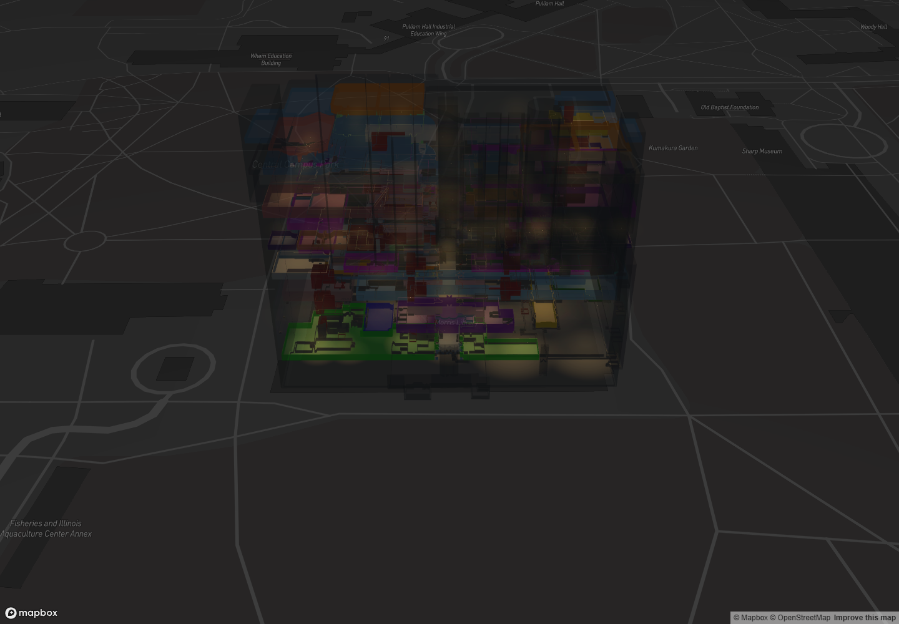
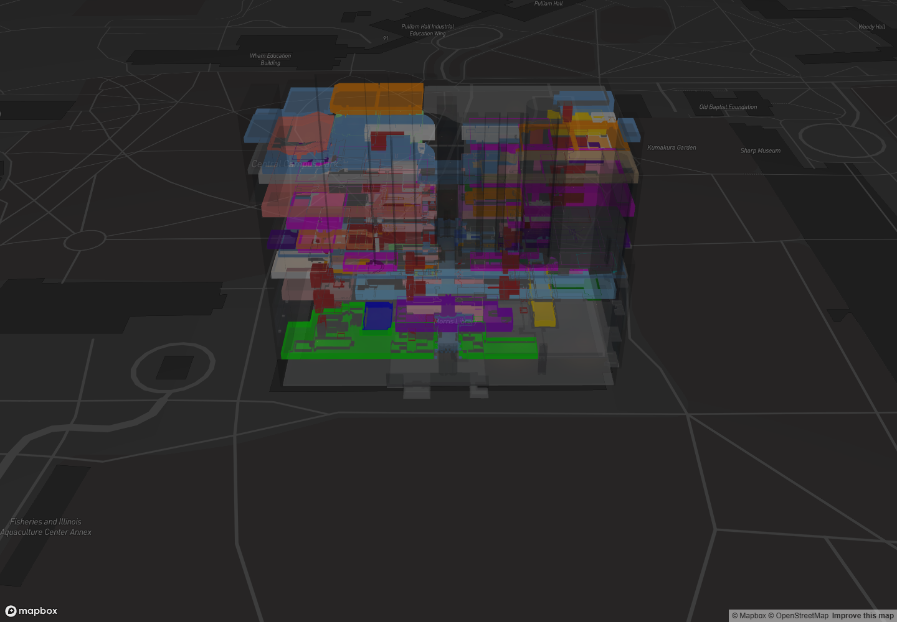
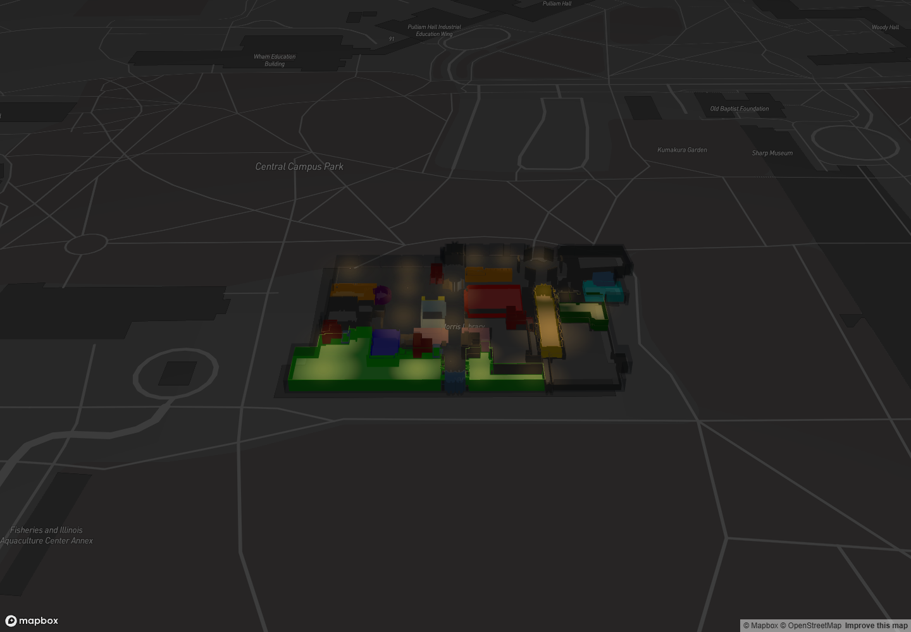
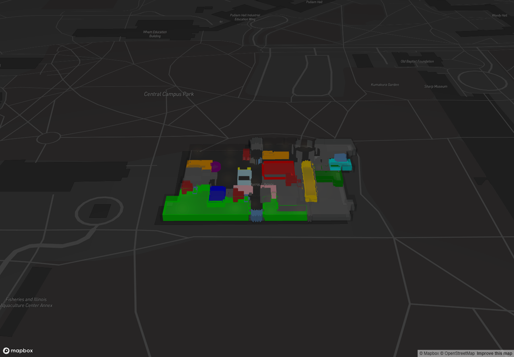

# Architectural Night and GIS Night

Both styles are configurations of the existing Night Mode renderer. Architectural Night retains the established warm lighting treatment. GIS Night raises ambient room visibility, preserves thematic room colors more strongly, reduces decorative glow, and makes the exterior more transparent.

As confirmed during implementation, both styles continue to use the current combined `interior_lights.geojson`, preserving its source coordinates, radii and other attributes. The repository has seven separate floor exports and no F7 light file. No dataset was synthesized or changed; the combined source supplies 138 enabled fixtures across F0–F6, with ambient-only rendering on F7.

## Configuration and state

`NIGHT_PRESETS` in `src/utils/nightLightingConfig.js` contains two immutable configurations. `architectural` is the existing `NIGHT_LIGHTING_DEFAULTS` object; `gis` inherits it and overrides the parameters below. There are no duplicate shaders, material systems or building models.

| Parameter | Architectural Night | GIS Night |
| --- | ---: | ---: |
| `warmth` | 0.65 | 0.30 |
| `glowStrength` | 0.45 | 0.12 |
| `glowRadiusScale` | 1.10 | 0.85 |
| `coreBrightness` | 0.65 | 0.40 |
| `surfaceIlluminationStrength` | 1.40 | 0.50 |
| `roomAmbient` | 0.075 | 0.55 |
| `wallAmbient` | 0.045 | 0.35 |
| `surfaceColorRetention` | 0.65 | 1.00 |
| `boundaryTransmission` | 0.18 | 0.08 |
| `nightEnvelopeOpacity` | 0.18 | 0.10 |
| `floorEdgeStrength` | 0.08 | 0.20 |

All other existing defaults are shared, including exposure 1, core pixel limits 0.35–1.4, floor geometry/opacity and charcoal envelope colors. Stacked envelope opacity uses the existing 0.8 multiplier, giving 0.144 and 0.08 respectively. There is no postprocessing bloom pass, so neither preset exposes a nonfunctional bloom setting.

`useNightPreset` owns the selected style, target settings and currently rendered settings in `App`. Architectural Night is the initial selection. Turning Night Mode off or changing floors leaves the selected style and slider adjustments intact for the mounted application session. Choosing another style applies that style's defaults; the existing sliders remain available for tuning. Reloading the application starts with Architectural Night again.

The compact native radio group appears immediately below the Night mode toggle in Visual settings. Its labels are Architectural Night and GIS Night; it supports keyboard arrow navigation and touch targets at least 44 pixels high. The selector shares the existing settings panel and adds no map overlay.

## Transitions and rendering updates

Preset changes interpolate numeric visual settings with a bounded smoothstep over 550 ms. A new selection starts from the current interpolated state, so rapid reversals remain continuous. One temporary animation schedule in `App` serves the main map and route timeline maps; it stops at completion and is cancelled on a new target, unmount or leaving Night Mode. Reduced-motion preferences apply the target immediately and are monitored for changes.

The renderer receives new settings through its existing `nightTuning` prop. Surface illumination updates shader uniforms. Fixture colors/radii and shell appearance update through existing layer properties. Stable layer IDs, data objects, source fields and GPU textures are retained while changing styles. Geometry, floor datums, `z_height = 4.3`, camera state and route data are not interpolated.

Room/wall color update triggers now depend only on the few settings actually stored in those vertex attributes. These are shared between presets, so changing the surface-light uniforms does not regenerate room vertex colors or positions. Fixture and shell triggers also track their specific inputs. No dataset fetch is tied to preset selection, and no dynamic shadow lights or permanent render loop were added.

## Room colors and navigation

Architectural Night allows more source-colored illumination over the existing room reflectance. GIS Night uses full source room-color retention in the surface-light multiplication, substantially higher ambient illumination and a weaker light contribution. Unlit small rooms therefore remain legible, and adjacent thematic colors remain distinct. These are shaded colors, not a promise of exact RGB equality with the GeoJSON values.

Both configurations share the existing navigation-color bypass for highlighted rooms, route endpoints, landmarks and used connectors. Routes, labels and markers keep their own layers. No geometry or routing behavior was changed.

## Files changed for this extension

- `src/utils/nightLightingConfig.js`: preset definitions, labels, default key and interpolation helper.
- `src/hooks/useNightPreset.js`: session selection, interrupted transitions and reduced-motion handling.
- `src/App.jsx`: one shared preset state for controls and all map views.
- `src/components/VisualControls.jsx`, `src/App.css`: compact accessible style selector.
- `src/components/IndoorBuilding.jsx`: avoid irrelevant room/wall attribute invalidation during transitions.
- `src/layers/interiorLightLayer.js`, `src/utils/interiorLighting.js`: narrow visual update triggers.
- `src/utils/nightPresets.test.js`: color legibility, bounded transitions and shared source/elevation regressions.
- `review/lighting-review.jsx`: expose the same preset hook in the existing review harness.

## Verification and limitations

The review harness uses the real map component and the same preset hook. It checks all floors in both styles, unchanged source positions, transition bounds, geometry/model/buffer/texture reuse, protected navigation colors, room picking, rapid switching, day/night memory, reduced motion and cinematic/camera behavior. Browser diagnostics and control measurements are recorded in [browser-results.json](browser-results.json).

The expected fixture counts remain F0 19, F1 20, F2 23, F3 16, F4 23, F5 19, F6 18, F7 0, and F-ALL 138. Day-mode restoration is compared against the original fresh day rendering with the asynchronous basemap hidden.

- Production build: passed; the existing large-bundle warning remains.
- Focused preset/lighting suite: 23 tests passed.
- Full application and routing suite: 102 passed, 11 failed. The failures are the same pre-existing two color-restoration assertions and nine missing-room lookup failures documented in the preceding lighting refinement.
- All 51 GeoJSON files match their hashes recorded before this extension.
- Both presets render on every floor with identical fixture coordinates and counts. Picking and protected navigation colors remain functional in both.
- The light source is not fetched again during preset changes, floor changes, rapid reversals or day/night cycling. The review page has two initial requests because it separately reads the source to establish its camera center; zero additional requests occur during the checks.
- The captured transition retains the same polygon data, vertex arrays, position buffer, model, source field and shared GPU texture. Sampled visual settings remain within the two preset endpoints.
- After GIS Night, restored Day Mode is pixel-identical to the original fresh day rendering with the basemap hidden. Session selection and reduced-motion behavior pass.
- The application controls pass at 1440×1000, 768×1024 and 390×844. Both options measure 44 pixels high, remain within the viewport, and work inside the existing compact navigation drawer. Native arrow-key selection and day/night selection retention pass.

Verification uses headless Chrome with software WebGL. Resource reuse is checked directly; this does not establish frame-rate performance on mobile GPUs. The transition has a nominal 550 ms duration; under software-rendering load the first sampled completed frame arrived around 770 ms, with intermediate values and no overshoot. Existing alpha-blending limitations and the absence of physical glazing, furniture, reflections or shadow geometry remain. No architectural details were invented.

## Matched-camera comparisons

The captures use 1440×1000 pixels, longitude −89.22048248, latitude 37.71531609, zoom 18.3, pitch 55° and bearing 0°.

| Architectural Night | GIS Night |
| --- | --- |
|  |  |
|  |  |

Additional captures: [GIS route/highlights](gis-route.png), [restored Day Mode](day-after-gis.png), [desktop controls](controls-1440.png), [tablet controls](controls-768.png), [phone controls](controls-390.png).

For manual review, run the development server and open `/review/lighting-review.html`. In the browser console, `review.selectPreset('gis')`, `review.selectPreset('architectural')`, `review.setFloor(1)` and `review.setFloor('all')` exercise the same configurations as the application. The review entry is not part of the production build.
